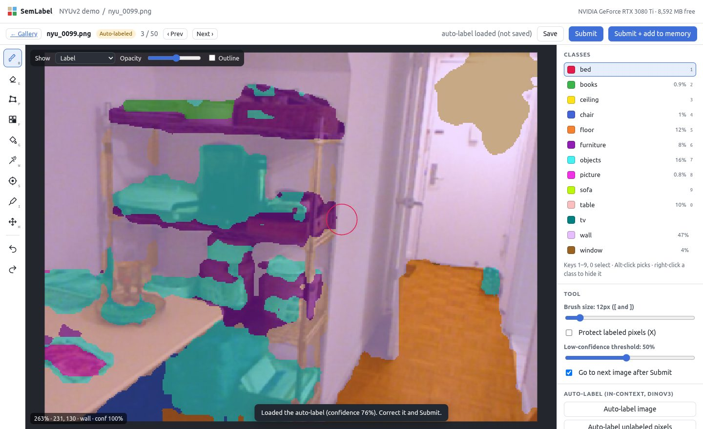
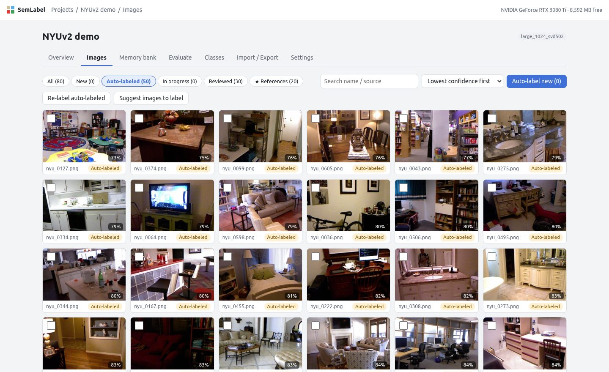
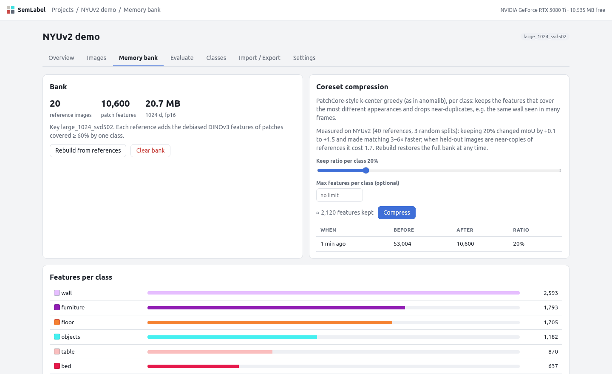

# SemLabel

**Label a few images, and DINOv3 labels the rest.** SemLabel is a local web app for pixel-level
semantic labeling (indoor scenes by default). You label a handful of reference images, add them to a
**memory bank**, and every other image is auto-labeled by matching frozen
[DINOv3](https://github.com/facebookresearch/dinov3) features against the bank, following
[INSID3](https://github.com/visinf/INSID3) (training-free in-context segmentation, CVPR 2026).
You then review the auto-labels, least confident first, and feed corrections back into the bank.

Nothing is trained. A new class needs one labeled example; a new site needs a few references from it.



- **Full labeling editor**: brush, polygon, superpixel fill, bucket fill, a DINOv3 "magic wand", SAM 2.1
  clicks, undo/redo, low-confidence overlay, keyboard-driven review queue.
- **In-context auto-labeling**: about 0.2–0.3 s per image on an RTX 3080 Ti, with a confidence map.
- **Memory bank with coreset compression** (PatchCore k-center greedy, as in
  [anomalib](https://github.com/open-edge-platform/anomalib)): drop near-duplicate features, keep coverage.
- **Active learning**: *Suggest images to label* picks the images least covered by the bank;
  evaluation on held-out reviewed images tracks quality as the bank grows.
- **Data in, data out**: images, folders, videos, ROS 2 bags (`.mcap`); export index / colour PNG masks,
  COCO (RLE) and CVAT *Segmentation mask 1.1*; import existing masks or CVAT exports.
- **Local and self-contained**: FastAPI + SQLite + files, no account, no internet after setup.

## Requirements

- Linux with an NVIDIA GPU (8 GB or more recommended; tested on a 12 GB RTX 3080 Ti). CPU works, slowly.
- Python 3.10+, `git`, and either [`uv`](https://docs.astral.sh/uv/) or `python3-venv`.
- The DINOv3 weights from Meta (free, but you must accept their licence; see below).
- About 6 GB of disk: 4 GB for the environment, 1.2 GB for the ViT-L weights, 1.2 GB for the optional
  SAM 2.1 and SegFormer weights.

## Install

```bash
git clone https://github.com/NingMingHao/semlabel.git
cd semlabel
scripts/install.sh --extras        # venv in .venv, PyTorch (CUDA 12.6), SemLabel, DINOv3 code, SAM + SegFormer
```

Options: `--torch cu128` (newer GPUs / drivers) or `--torch cpu`, `--venv PATH`, `--test` (pytest +
Playwright), and leave out `--extras` to skip the optional models (`semlabel download-extras` later).

**DINOv3 weights.** Request access on Meta's
[DINOv3 downloads page](https://ai.meta.com/resources/models-and-libraries/dinov3-downloads/), then put
the checkpoint(s) in `~/.semlabel/weights/`. The default backbone needs
`dinov3_vitl16_pretrain_lvd1689m-8aa4cbdd.pth`; the optional ones are listed by `semlabel doctor`.

Check everything:

```bash
./semlabel.sh doctor --load
```

## Run

```bash
./semlabel.sh                      # http://127.0.0.1:8765
./semlabel.sh --host 0.0.0.0       # reachable from other machines on your network
```

Open the address in Chrome or Firefox. Projects, images and labels are stored in `~/.semlabel/data`.
`semlabel.sh` uses the venv without activating it and clears `PYTHONPATH`, so it is safe to run from a
ROS 2 shell. To run it in the background: `setsid nohup ./semlabel.sh > ~/.semlabel/server.log 2>&1 &`
(stop with `pkill -f "semlabel"`), or see [the user guide](docs/USER_GUIDE.md#keep-it-running) for a
systemd user service.

## Quick start

1. **New project** → keep the *Indoor (16 classes)* template or enter your own classes.
2. **Import / Export** → drop images, or give a folder, video or ROS 2 bag path on the server.
3. **Images** → *Suggest images to label* (picks the most diverse ones) → open the first.
4. Label it: *Pre-label (SegFormer)* for a head start, then fix with the brush (`B`), SAM clicks (`S`),
   magic wand (`W`) or bucket fill (`G`). Press **Ctrl+Shift+Enter** (*Submit + add to memory*).
5. After 5–10 references, **Auto-label new**. Then sort by *Lowest confidence first*, fix, Submit.
6. **Evaluate** to see quality on reviewed images that are not references; **Export** when done.

| Gallery, sorted for review | Memory bank and coreset compression |
|---|---|
|  |  |

Details, every tool and all shortcuts: **[docs/USER_GUIDE.md](docs/USER_GUIDE.md)**.

## Configuration

Settings live in `~/.semlabel/semlabel.env` (written by the installer); real environment variables
take precedence.

| variable | default | |
|---|---|---|
| `SEMLABEL_DATA` | `~/.semlabel/data` | projects, images, labels, memory banks |
| `SEMLABEL_WEIGHTS` | `~/.semlabel/weights` | DINOv3 `.pth` checkpoints |
| `SEMLABEL_DINOV3_REPO` | `~/.semlabel/dinov3` | DINOv3 model code (cloned by the installer) |
| `SEMLABEL_VENV` | `./.venv` | environment used by `semlabel.sh` |
| `SEMLABEL_SAM` | `facebook/sam2.1-hiera-large` | SAM checkpoint for the click tool |
| `SEMLABEL_HOME` | `~/.semlabel` | base folder for the defaults above |

Per-project engine settings (backbone, mode, neighbours, compression, …) are in the project's
*Settings* tab.

## How it works and how well

Each image becomes a grid of DINOv3 ViT-L/16 patch features. INSID3's positional debiasing removes the
part of each feature that encodes *where* a patch is. Every patch then gets class votes from its nearest
neighbours in the memory bank. INSID3's clustering and seed-and-aggregate scoring turn those votes into
coherent regions. The details are in [docs/ARCHITECTURE.md](docs/ARCHITECTURE.md).

On NYUv2 (13 indoor classes, 100 held-out images; [docs/BENCHMARK.md](docs/BENCHMARK.md)):

| references in the bank | 5 | 10 | 20 | 40 |
|---|---|---|---|---|
| mIoU, ViT-L/16 (default) | 49.6 | 56.7 | 59.1 | 63.8 |

ViT-L beats ViT-S, ViT-B and ViT-H+ at every budget, positional debiasing adds about 5 mIoU, and keeping
20 % of the bank via the coreset is accuracy-neutral while making matching 3–6× faster.

## Development

```bash
scripts/install.sh --test
.venv/bin/python -m pytest -q                 # 18 tests; the ones needing DINOv3 weights skip without them
.venv/bin/python tests/ui_flow.py http://127.0.0.1:8765 <folder of images> <screenshot dir>   # browser end-to-end
```

Optional ROS 2 bag test: set `SEMLABEL_TEST_BAG` (an `.mcap` file or bag folder) and
`SEMLABEL_TEST_BAG_TOPIC` (an image topic in it). Reproduce the benchmark with
`pip install -e ".[bench]"`, `python scripts/prepare_nyu.py` and `bench/run_sweeps.sh`.

## Licence and credits

SemLabel is released under the [Apache License 2.0](LICENSE). It re-implements ideas from INSID3
(Apache-2.0) and anomalib (Apache-2.0), and uses DINOv3, SAM 2.1 and (optionally) SegFormer under their
own licences; the DINOv3 weights and the SegFormer checkpoint have their own terms. See
[THIRD_PARTY.md](THIRD_PARTY.md).

If SemLabel is useful in research, please cite the work it builds on:

```bibtex
@inproceedings{cuttano2026insid3,
  title     = {{INSID3}: Training-Free In-Context Segmentation with {DINOv3}},
  author    = {Claudia Cuttano and Gabriele Trivigno and Christoph Reich and Daniel Cremers and Carlo Masone and Stefan Roth},
  booktitle = {Proceedings of the IEEE/CVF Conference on Computer Vision and Pattern Recognition (CVPR)},
  year      = {2026}
}
@misc{simeoni2025dinov3,
  title         = {{DINOv3}},
  author        = {Sim{\'e}oni, Oriane and Vo, Huy V. and Seitzer, Maximilian and others},
  year          = {2025},
  eprint        = {2508.10104},
  archivePrefix = {arXiv},
  primaryClass  = {cs.CV}
}
```
